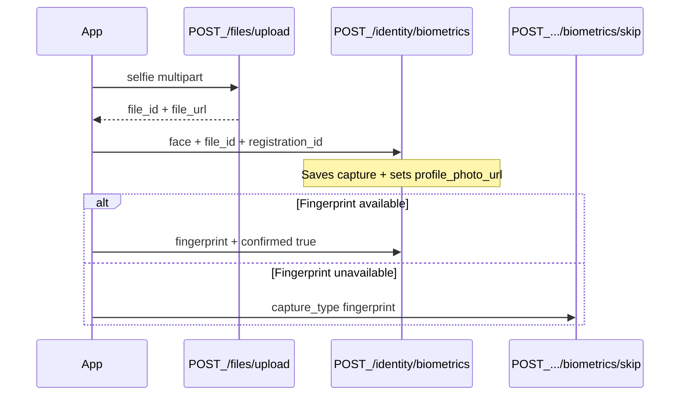

# JUPEB onboarding — biometrics & selfie (mobile guide)

Auth: all endpoints require `Authorization: Bearer <access_token>`.

Envelope: responses use `{ "success": true|false, "message": "...", "data": ... }`.

---

## Overview

| Capture | How it works on device | What you send to the API |
|--------|-------------------------|---------------------------|
| **Face (selfie)** | Capture photo → upload file → register biometric | `file_id` from upload (**not** `external_reference`) |
| **Fingerprint** | Device biometric / local auth only (no file or token) | `confirmed: true` **or** skip |

**Do not skip face** if you captured a selfie. Skipping locks self-service re-capture for that type.

There is **no separate “update candidate after biometric” call**. Saving the capture (and the selfie file) is enough:

- Face + `file_id` → durable photo on the candidate profile (replaces expiring NIN photo)
- Capture rows + skip flags drive `biometric_status` on registration detail / submission preview

---

## Critical: `file_id` vs `confirmed` / `external_reference`

| Field | Use for | Wrong usage |
|-------|---------|-------------|
| `file_id` | Face selfie (UUID from `POST /files/upload`) | Putting the upload UUID in `external_reference` |
| `confirmed: true` | Fingerprint after successful device-local auth (preferred) | Face captures |
| `external_reference` | Optional fingerprint vault/token string (legacy / if you have one) | Face selfie file id |

If face is stored with only `external_reference`:

- Profile photo is **not** updated
- `GET /identity/registrations/{id}/photo` returns **404**

---

## Step-by-step flow

```text
1. Candidate has a registration_id (after claim / onboarding).
2. FACE
   a. Capture selfie on device
   b. POST /files/upload  →  file_id
   c. POST /identity/biometrics  { capture_type: "face", file_id, registration_id }
3. FINGERPRINT
   a. If device auth succeeds:
      POST /identity/biometrics  { capture_type: "fingerprint", confirmed: true, registration_id }
   b. If unavailable / user skips:
      POST /identity/registrations/{registrationId}/biometrics/skip  { capture_type: "fingerprint" }
4. Continue onboarding (no extra profile/photo PATCH required for the selfie).
```



---

## 1. Upload selfie — `POST /files/upload`

**Content-Type:** `multipart/form-data`

| Field | Type | Required | Notes |
|-------|------|----------|--------|
| `file` | binary | yes | Image (jpeg/png) |
| `context` | string | no | Prefer `jupeb_biometric` (default `general`) |

### Example request

```http
POST /files/upload
Authorization: Bearer <token>
Content-Type: multipart/form-data

file: <selfie.jpg>
context: jupeb_biometric
```

### Example response — `201`

```json
{
  "success": true,
  "message": "File uploaded successfully",
  "data": {
    "id": "a1b2c3d4-e5f6-7890-abcd-ef1234567890",
    "file_id": "a1b2c3d4-e5f6-7890-abcd-ef1234567890",
    "url": "https://cdn.example.com/jupeb_biometric/....jpg",
    "file_url": "https://cdn.example.com/jupeb_biometric/....jpg",
    "file_type": "image/jpeg",
    "file_size": 245678,
    "provider": "s3",
    "metadata": {},
    "uploaded_at": "2026-07-21T09:00:00.000Z"
  }
}
```

**Mobile:** keep `data.file_id` (same as `data.id`) for the next call.

---

## 2. Register face biometric — `POST /identity/biometrics`

### Request body

| Field | Type | Required | Notes |
|-------|------|----------|--------|
| `registration_id` | uuid | yes | Candidate registration |
| `capture_type` | `"face"` | yes | |
| `file_id` | uuid | yes* | From upload (`*` XOR with `external_reference` — use **file_id** for face) |
| `quality_score` | number 0–1 | no | If server sets `JUPEB_FACE_MIN_QUALITY`, scores below it → `422` |
| `device_metadata` | object | no | Optional device info |
| `captured_at` | ISO-8601 | no | Defaults to server now |

### Example request

```http
POST /identity/biometrics
Authorization: Bearer <token>
Content-Type: application/json

{
  "registration_id": "11111111-2222-3333-4444-555555555555",
  "capture_type": "face",
  "file_id": "a1b2c3d4-e5f6-7890-abcd-ef1234567890",
  "quality_score": 0.92,
  "device_metadata": {
    "platform": "ios",
    "model": "iPhone 15"
  }
}
```

### Example response — `201`

```json
{
  "success": true,
  "message": "Biometric capture created",
  "data": {
    "id": "bbbbbbbb-bbbb-bbbb-bbbb-bbbbbbbbbbbb",
    "registration_id": "11111111-2222-3333-4444-555555555555",
    "capture_type": "face",
    "file_id": "a1b2c3d4-e5f6-7890-abcd-ef1234567890",
    "external_reference": null,
    "quality_score": "0.92",
    "device_metadata": { "platform": "ios", "model": "iPhone 15" },
    "captured_at": "2026-07-21T09:00:05.000Z",
    "created_at": "2026-07-21T09:00:05.000Z",
    "replaced_at": null
  }
}
```

### Side effect (important)

On success with `capture_type: "face"` + `file_id`, the backend also sets:

`profiles.profile_photo_url` = durable `files.file_url`

Candidate UIs (`submission-preview`, institution views, etc.) prefer this over the NIN provider photo (which expires).

### Common errors

| Status | When |
|--------|------|
| `422` | Missing fields, both/neither of `file_id`/`external_reference`, quality too low |
| `404` | `file_id` not found |
| `409` | Active face capture already exists — use **replace** (below) |
| `403` | Face was previously skipped (self-service locked) |

---

## 3. Fingerprint (device-local) — `POST /identity/biometrics`

No file upload and **no token to send**. After successful device biometric / local auth, send `confirmed: true`.

### Example request

```http
POST /identity/biometrics
Authorization: Bearer <token>
Content-Type: application/json

{
  "registration_id": "11111111-2222-3333-4444-555555555555",
  "capture_type": "fingerprint",
  "confirmed": true,
  "device_metadata": {
    "auth_type": "biometrics",
    "platform": "android"
  }
}
```

The server stores `external_reference = "device_local_auth"` so the DB row remains valid. You do not need to invent a string client-side.

`external_reference` is still accepted if you ever have a real vault/token value.

### Example response — `201`

Same shape as face, with `capture_type: "fingerprint"`, `file_id: null`, and `external_reference: "device_local_auth"`.

---

## 4. Skip fingerprint — `POST /identity/registrations/{registrationId}/biometrics/skip`

Use when fingerprint / device biometrics is unavailable or the user skips.

### Example request

```http
POST /identity/registrations/11111111-2222-3333-4444-555555555555/biometrics/skip
Authorization: Bearer <token>
Content-Type: application/json

{
  "capture_type": "fingerprint"
}
```

### Example response — `200`

```json
{
  "success": true,
  "message": "Biometric capture skipped",
  "data": {
    "id": "11111111-2222-3333-4444-555555555555",
    "fingerprint_skipped_at": "2026-07-21T09:01:00.000Z",
    "face_skipped_at": null
  }
}
```

**Lock:** after skip, the candidate cannot self-serve `POST /identity/biometrics` for that `capture_type` (returns `403`). Institution/privileged roles can still capture on their behalf.

You can also skip `face` the same way — only if product allows skipping selfie (normally you should upload + register face instead).

---

## 5. Replace a capture — `PUT /identity/biometrics/{captureId}`

When you get `409` on create, or the user retakes the selfie:

1. Upload a new file (`POST /files/upload`) if face
2. Replace using the **existing capture id**

### Example request (face retake)

```http
PUT /identity/biometrics/bbbbbbbb-bbbb-bbbb-bbbb-bbbbbbbbbbbb
Authorization: Bearer <token>
Content-Type: application/json

{
  "file_id": "cccccccc-cccc-cccc-cccc-cccccccccccc",
  "quality_score": 0.95
}
```

### Example response — `200`

New capture row (`data.id` is new). Old row gets `replaced_at` set. Face + `file_id` again updates `profile_photo_url`.

---

## 6. Optional helpers

### List captures — `GET /identity/registrations/{registrationId}/biometrics`

Returns all captures (including replaced). Active = `replaced_at == null`.

### Registration photo — `GET /identity/registrations/{registrationId}/photo`

Returns the latest face capture that has a `file_id`:

```json
{
  "success": true,
  "message": "Registration photo URL",
  "data": {
    "url": "https://cdn.example.com/....jpg",
    "file_id": "a1b2c3d4-e5f6-7890-abcd-ef1234567890",
    "file_type": "image/jpeg",
    "captured_at": "2026-07-21T09:00:05.000Z"
  }
}
```

`404` if there is no face row with `file_id`.

For general candidate display, prefer `candidate.photo_url` / `profile_photo_url` from registration / submission-preview APIs after a successful face+`file_id` capture — those use the durable profile photo.

---

## Pseudocode (recommended)

```ts
// FACE
const upload = await api.uploadFile({ file: selfieBlob, context: 'jupeb_biometric' });
await api.post('/identity/biometrics', {
  registration_id: registrationId,
  capture_type: 'face',
  file_id: upload.file_id, // NOT external_reference
  quality_score: score,    // optional
});

// FINGERPRINT
if (await deviceLocalAuth.success()) {
  await api.post('/identity/biometrics', {
    registration_id: registrationId,
    capture_type: 'fingerprint',
    confirmed: true,
  });
} else {
  await api.post(`/identity/registrations/${registrationId}/biometrics/skip`, {
    capture_type: 'fingerprint',
  });
}

// No extra PATCH for candidate photo — backend already set profile_photo_url.
```

---

## Checklist for mobile

- [ ] Face upload uses `POST /files/upload`, then biometrics with **`file_id`**
- [ ] Never put the uploaded file UUID in `external_reference`
- [ ] Fingerprint uses `confirmed: true` or skip — never a fake file upload
- [ ] Do not rely on NIN photo URL long-term (it expires); selfie becomes the durable photo
- [ ] On `409`, call replace (`PUT`) instead of create again
- [ ] After skip, do not expect self-service re-capture for that type (show “contact institution” if needed)
