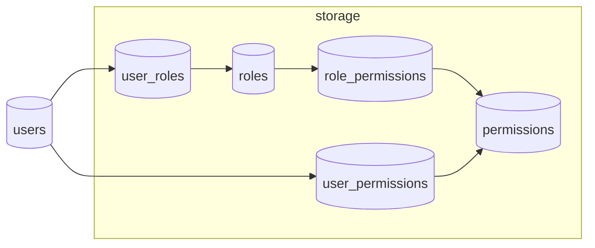

# Roles and permissions

This document describes how role-based access control (RBAC) is modeled in the database, how permissions are resolved for a user, and the canonical lists of roles and permissions. Source of truth for seeds: `src/db/seeds/002_seed_rbac.sql` (core RBAC), plus `src/db/migrations/003_ocr_schema.sql` (OCR permissions and grants).

---

## Flow (how it works)

1. **Roles** are rows in `roles`. Users are linked to roles through `user_roles` (many-to-many). Role assignments can optionally expire via `expires_at`.

2. **Permissions** are rows in `permissions`. Each row has a stable **`name`** (e.g. `users.view`), a **`resource`**, an **`action`**, and a **`description`**. The pair `(resource, action)` is unique in the core seed.

3. **Role → permission** links live in `role_permissions`. A user with a role inherits all permissions attached to that role (unless overridden; see below).

4. **User overrides** live in `user_permissions`: you can **grant** (`granted = true`) or **deny** (`granted = false`) a specific permission for a user. Deny wins over role-derived grants for the same permission.

5. **Runtime check** (conceptually): a user is allowed a permission if they hold it through **any** active role or an active **direct grant**, and there is **no** active explicit **deny** for that permission. Implementation: `hasPermission` / `getUserPermissions` in `src/shared/middleware/rbac.middleware.js`.

6. **API enforcement** uses two common patterns:
   - **`requireRole('a', 'b', …)`** — user must have at least one of the named roles (many JUPEB and admin routes).
   - **`requirePermission('x', 'y', …)`** — user must have at least one of the named permissions (e.g. `users.view`, `users.create`).

7. **New permissions in the database** do not change behavior until **application code** references that permission name (or assigns it for use by existing checks). Creating a row only defines what can be assigned; routes must opt in with `requirePermission` / `hasPermission`.

---

## Roles

| `name` (technical) | Display name | Description |
|--------------------|--------------|-------------|
| `super_admin` | Super Admin | Full system access and administration |
| `admin` | Administrator | Full management access |
| `agent` | Agent | Support agent with limited management access |
| `user` | User | Regular user with basic access |
| `registrar` | Registrar | JUPEB registrar operations (catalog, sessions, numbering) |
| `program_director` | Program Director | Institution program director (NIN verify, provisional registration) |
| `institution_admin` | Institution Admin | Institution-level administration |
| `financial_admin` | Financial Admin | JUPEB finance reporting and reconciliation |
| `student` | Student | JUPEB student participant (registration, finance, submissions) |

All seeded roles are marked **system** roles (`is_system = true`).

---

## Permissions (core seed)

Listed in the same groupings as `002_seed_rbac.sql`.

### System

| Name | Resource | Action | Description |
|------|----------|--------|-------------|
| `system.admin` | system | admin | Full system administration access |
| `system.config` | system | config | Manage system configuration |
| `system.logs` | system | logs | View system logs |

### Permission management (RBAC meta)

| Name | Resource | Action | Description |
|------|----------|--------|-------------|
| `permissions.view` | permissions | view | View permissions |
| `permissions.remove` | permissions | remove | Remove permissions from users |

### Role management

| Name | Resource | Action | Description |
|------|----------|--------|-------------|
| `roles.create` | roles | create | Create new roles |
| `roles.update` | roles | update | Edit roles |
| `roles.delete` | roles | delete | Delete roles |
| `roles.view` | roles | view | View role details |

### Session management

| Name | Resource | Action | Description |
|------|----------|--------|-------------|
| `sessions.create` | sessions | create | Create new sessions |
| `sessions.update` | sessions | update | Edit sessions |
| `sessions.delete` | sessions | delete | Delete sessions |
| `sessions.view` | sessions | view | View sessions |

### User management

| Name | Resource | Action | Description |
|------|----------|--------|-------------|
| `users.view` | users | view | View user profiles |
| `users.create` | users | create | Create new users |
| `users.update` | users | update | Update user profiles |
| `users.delete` | users | delete | Delete users |

### Institution management

| Name | Resource | Action | Description |
|------|----------|--------|-------------|
| `institutions.create` | institutions | create | Create institutions |
| `institutions.update` | institutions | update | Edit institutions |
| `institutions.delete` | institutions | delete | Delete institutions |
| `institutions.view` | institutions | view | View institutions |

### Subject management

| Name | Resource | Action | Description |
|------|----------|--------|-------------|
| `subject.create` | subject | create | Create subjects |
| `subject.view` | subject | view | View subject details |
| `subject.update` | subject | update | Edit subjects |
| `subject.delete` | subject | delete | Delete subjects |

### Subject combination management

| Name | Resource | Action | Description |
|------|----------|--------|-------------|
| `subject_combinations.create` | subject_combinations | create | Create subject combinations |
| `subject_combinations.update` | subject_combinations | update | Edit subject combinations |
| `subject_combinations.view` | subject_combinations | view | View subject combinations |
| `subject_combinations.delete` | subject_combinations | delete | Delete subject combinations |

### Payments and reporting

| Name | Resource | Action | Description |
|------|----------|--------|-------------|
| `payments.view` | payments | view | View payments |
| `activity_logs.view` | activity_logs | view | View activity log |
| `reports.view` | reports | view | View reports |
| `reports.export` | reports | export | Export reports |

### JUPEB / profiles

| Name | Resource | Action | Description |
|------|----------|--------|-------------|
| `jupeb.catalog.manage` | jupeb | catalog | Manage JUPEB catalog (universities, subject combinations) |
| `jupeb.identity.verify` | jupeb | identity_verify | Verify NIN and access identity proofs |
| `profiles.jupeb_university_id` | profiles | jupeb_university_id | Institution-scope binding for JUPEB (`profiles.jupeb_university_id`) |

Institution registration routes under `/registration/institution/registrations/*` and `PATCH /identity/nin/verifications/:id/intake` are enforced with **`requireRole`** in application code (not separate rows in this table): typically `admin`, `super_admin`, `registrar`, `program_director`, and `institution_admin`, with `profiles.jupeb_university_id` scoping for the two institution roles where applicable.

---

## Permissions (OCR migration)

Inserted by `003_ocr_schema.sql` (not duplicated in `002_seed_rbac.sql`).

| Name | Resource | Action | Description |
|------|----------|--------|-------------|
| `ocr.create` | ocr | create | Submit OCR jobs for own files |
| `ocr.read` | ocr | read | Read OCR jobs for own files |
| `ocr.read.any` | ocr | read.any | Read OCR jobs for any file (staff) |
| `ocr.requirement.bind` | ocr | requirement.bind | Bind OCR results to JUPEB submission requirements |

---

## Default role → permission grants (seeded)

| Role | Permissions granted by seed |
|------|-----------------------------|
| `super_admin` | **All** permissions present in `permissions` at seed time (cross join in seed). |
| `admin` | **All** permissions present in `permissions` at seed time. |
| `agent` | `users.view`, `users.update` |
| `registrar` | `jupeb.catalog.manage`; also `jupeb.identity.verify`; OCR migration adds full OCR set for registrar (see below). |
| `program_director` | `jupeb.identity.verify` |
| `institution_admin` | `jupeb.identity.verify`; `profiles.jupeb_university_id` |
| `user` | No grants from `002_seed_rbac.sql`; OCR migration grants `ocr.create`, `ocr.read`. |
| `student` | No grants from `002_seed_rbac.sql`; OCR migration grants `ocr.create`, `ocr.read`. |
| `financial_admin` | No `role_permissions` rows in `002_seed_rbac.sql`; finance APIs use **role names** in route middleware. |

### OCR migration grants (`003_ocr_schema.sql`)

- **`user`**, **`student`**: `ocr.create`, `ocr.read`
- **`admin`**, **`super_admin`**, **`registrar`**: `ocr.create`, `ocr.read`, `ocr.read.any`, `ocr.requirement.bind`

---

## Related files

| Area | Path |
|------|------|
| Role and permission seeds | `src/db/seeds/002_seed_rbac.sql` |
| OCR permissions + grants | `src/db/migrations/003_ocr_schema.sql` |
| Permission resolution | `src/shared/middleware/rbac.middleware.js` |
| Admin RBAC HTTP API | `src/modules/admin/routes.js` (RBAC section) |

---

## Changelog

Document generated to match repository seeds. When you add or rename permissions, update **`002_seed_rbac.sql`** (and any migrations) first, then refresh this file so product and engineering stay aligned.
